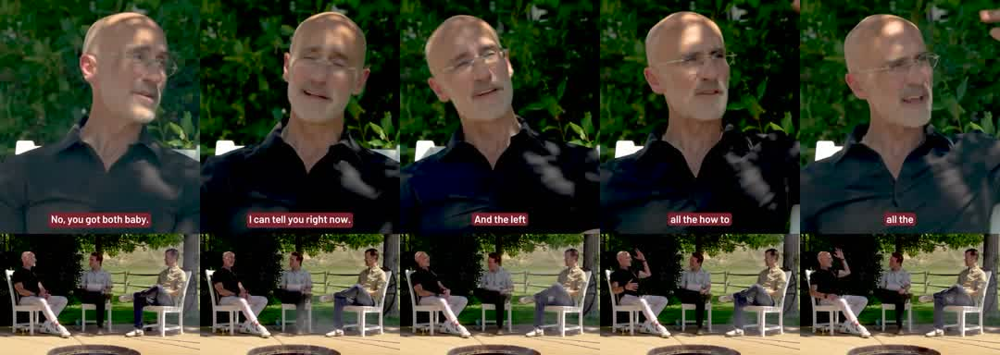

# v14_s04 · 13 Pantalla dividida · 9.9–14.9s (calidad 2)

- **Guion:** But you have both, baby. I can tell you right now. And the left hemisphere is all the how-to and what stuff,
- **Qué se ve:** Arriba Brooks primer plano riendo y luego explicando, gesto con la mano; abajo plano general.
- **Diseño:** Caption en caja granate ~61 %.
- **Efectos:** Igual.
- **Animación:** Plano continuo.
- **Por qué aquí:** Inicio de la explicación técnica (hemisferio izquierdo).
