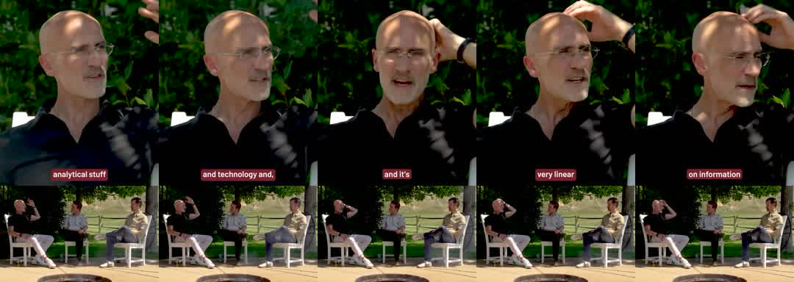

# v14_s05 · 13 Pantalla dividida · 14.9–19.3s (calidad 2)

- **Guion:** all the analytical stuff and technology, and it's very linear and it's based on information.
- **Qué se ve:** Fundido cruzado a otro tramo de Brooks (mano en la cabeza, señalando la sien); abajo plano general.
- **Diseño:** Caption en caja granate ~61 %.
- **Efectos:** Dissolve visible (imagen lavada/superpuesta ~0.5 s) en ambas mitades.
- **Animación:** Cross-dissolve ~0.5 s a los 15 s para ocultar un corte de edición.
- **Por qué aquí:** El gesto de tocarse la cabeza ilustra 'cerebro'; el dissolve disimula el salto.
