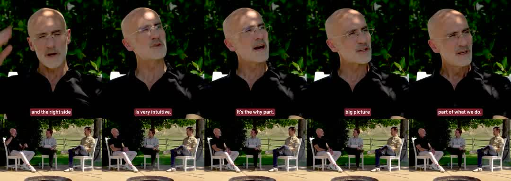

# v14_s06 · 13 Pantalla dividida · 19.3–24.6s (calidad 2)

- **Guion:** The right side is very intuitive. It's the why part, it's the big picture part of what we do.
- **Qué se ve:** Brooks primer plano mirando a la derecha, gesticulando; abajo plano general.
- **Diseño:** Caption en caja granate ~61 %.
- **Efectos:** Igual.
- **Animación:** Plano continuo.
- **Por qué aquí:** Contraste hemisferio derecho: sigue en cara (no hay gráfico de cerebro).
