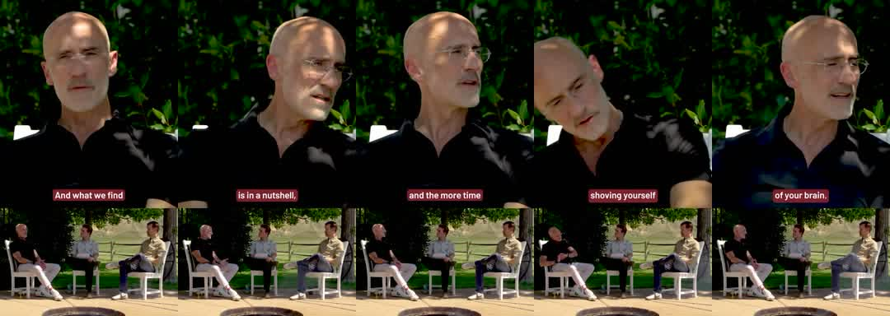

# v14_s07 · 13 Pantalla dividida · 24.6–32.8s (calidad 2)

- **Guion:** And what we find is in a nutshell, that the more time you spend inside and the more time you spend on your phone, the more you're shoving yourself in the left hemisphere of your brain.
- **Qué se ve:** Brooks primer plano; a los 30 s inclina la cabeza (gesto de 'empujar') y el encuadre se ajusta; abajo plano general.
- **Diseño:** Caption en caja granate ~61 %.
- **Efectos:** Igual.
- **Animación:** Plano continuo con reencuadre a los ~29.8 s.
- **Por qué aquí:** La tesis central ('pantallas = hemisferio izquierdo'): se mantiene la cara para el argumento clave.
