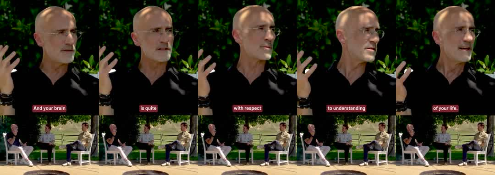

# v14_s08 · 13 Pantalla dividida · 32.8–36.4s (calidad 2)

- **Guion:** And your brain is quite literally broken with respect to understanding the meaning of your life.
- **Qué se ve:** Brooks primer plano con gesto amplio de la mano (pulseras); abajo plano general.
- **Diseño:** Caption en caja granate ~61 %.
- **Efectos:** Igual.
- **Animación:** Plano continuo.
- **Por qué aquí:** Frase fuerte ('broken'); el gesto de las manos aporta energía.
