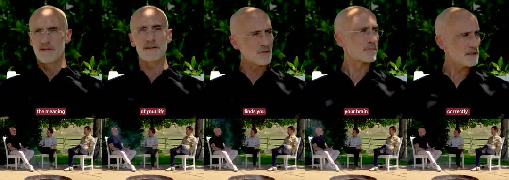

# v14_s10 · 13 Pantalla dividida · 44.9–49.6s (calidad 3)

- **Guion:** The meaning of your life finds you because you're using your brain correctly.
- **Qué se ve:** Brooks primer plano, frase de cierre; abajo plano general.
- **Diseño:** Caption en caja granate ~61 %.
- **Efectos:** Igual.
- **Animación:** Plano continuo; corte seco a negro.
- **Por qué aquí:** Frase-sentencia final en cara.
