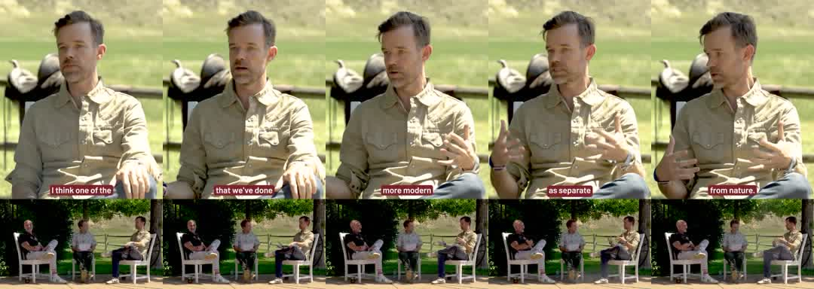

# v15_s01 · 13 Pantalla dividida · 0.0–6.2s (calidad 2)

- **Guion:** I think one of the things that we've done in the sort of more modern era is think of ourselves as separate and distinct from nature.
- **Qué se ve:** Pantalla dividida: arriba (~68 %) plano medio del invitado (hombre de ~40 años, camisa caqui de trabajo, barba corta) sentado, gesticulando, con sillas de montar y prado verde detrás; abajo (~32 %) plano general de los tres en sillas blancas de jardín (Brooks a la izquierda de negro).
- **Diseño:** División a ~68 % sin separador. Caption sans bold pequeña blanca en caja granate #7A2232, centrada sobre la costura (~65 % de altura), 3–5 palabras. Fondo de prado #B5B86A, camisa #A89A78.
- **Efectos:** Luz de mediodía, fondo desenfocado claro; sin textura.
- **Animación:** Caption por frase con corte seco; vídeo continuo.
- **Por qué aquí:** Hook de idea ('nos creemos separados de la naturaleza') en plano medio del que habla; abajo se ve que la charla ocurre en la naturaleza.
