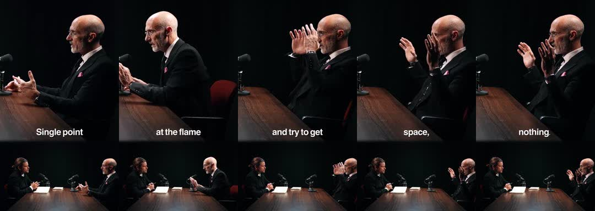

# v20_s04 · 13 Pantalla dividida · 11.1–17.3s (calidad 4)

- **Guion:** point meditation is where you look at the flame of a candle and try to get space to try to think about nothing. And
- **Qué se ve:** Pantalla dividida horizontal: arriba (~65 %) Brooks de perfil en la mesa haciendo gesto de mirar una llama con las manos; abajo (~35 %) plano general de la mesa larga de madera con ambos sentados frente a frente, micrófonos. Captions 'Single point', 'at the flame', 'and try to get', 'space,', 'nothing.' sobre la línea de unión.
- **Diseño:** División sin borde visible (corte directo entre paneles), caption centrado justo en la costura entre paneles. Fondo negro en ambos.
- **Efectos:** Low-key, mesa de madera cálida como única superficie iluminada.
- **Animación:** Paneles estáticos; el panel superior cambia de ángulo (perfil cercano → perfil más abierto).
- **Por qué aquí:** Cuando describe una acción (mirar la llama), el plano general muestra el contexto y el superior el gesto: describe → muestra, sin b-roll.
