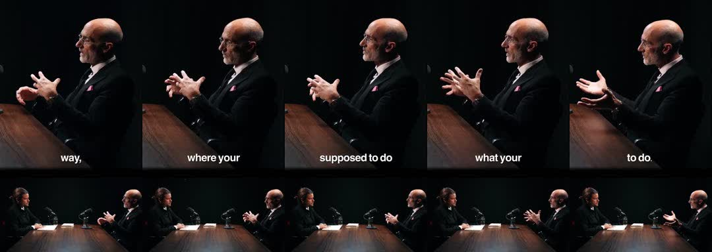

# v20_s09 · 13 Pantalla dividida · 41.7–44.5s (calidad 3)

- **Guion:** in a way through your brain is supposed to do what your brain is supposed to do.
- **Qué se ve:** Vuelve la pantalla dividida: arriba Brooks de perfil gesticulando con las manos, abajo plano general de la mesa; 'brain is', 'supposed'.
- **Diseño:** Igual que v20_s04.
- **Efectos:** Low-key.
- **Animación:** Paneles estáticos.
- **Por qué aquí:** Rompe la monotonía de primeros planos en el tramo final.
