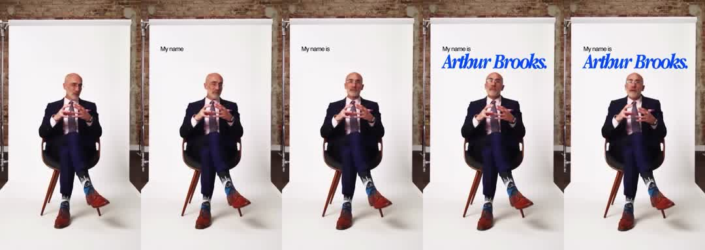

# v01_s02 · 14 Título - cierre - CTA · 1.0–2.3s (calidad 5)

- **Guion:** my name is Arthur Brooks.
- **Qué se ve:** Foto de estudio a cuerpo entero: Arthur sentado en silla de madera ante ciclorama blanco con pared de ladrillo en los bordes. Encima: 'My name is / Arthur Brooks.'
- **Diseño:** 'Arthur Brooks.' serif itálica bold de alto contraste (tipo Playfair Display Italic) en azul de acento ~#2E4FD8, ~7 % del alto; 'My name is' sans regular pequeña negra, alineada a la izquierda encima. Bloque en el tercio superior (≈22–26 % del alto), sobre la cabeza del personaje.
- **Efectos:** Foto limpia de alta clave, sin grano; profundidad natural del ciclorama.
- **Animación:** Corte seco desde A-roll; 'My name is' aparece primero y el nombre entra con write-on/pop por palabra sincronizado a 'Arthur'/'Brooks' (≈0.2 s cada uno). Leve push-in de la foto (≈102 %).
- **Por qué aquí:** Name card: tras el saludo se presenta al protagonista con su retrato más 'oficial'; el azul marca el nombre como dato de marca.
