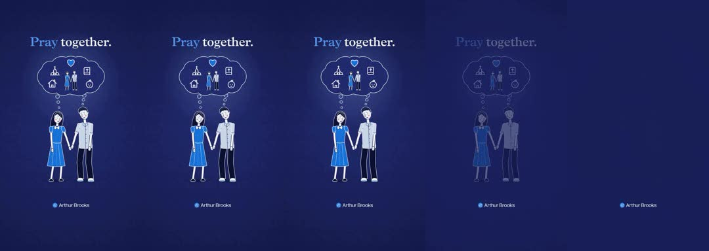

# v03_s05 · 14 Título - cierre - CTA · 11.5–12.9s (calidad 3)

- **Guion:** (música)
- **Qué se ve:** La ilustración y el título desaparecen; queda el fondo azul con la firma '● Arthur Brooks' centrada.
- **Diseño:** Firma sans pequeña blanca con punto azul, centrada a ~90 % alto (en la hoja aparece más baja que antes).
- **Efectos:** Gradiente azul liso.
- **Animación:** Fade-out general (≈0.5 s) dejando solo la marca.
- **Por qué aquí:** Cierre de marca limpio; el vacío final favorece el loop.
