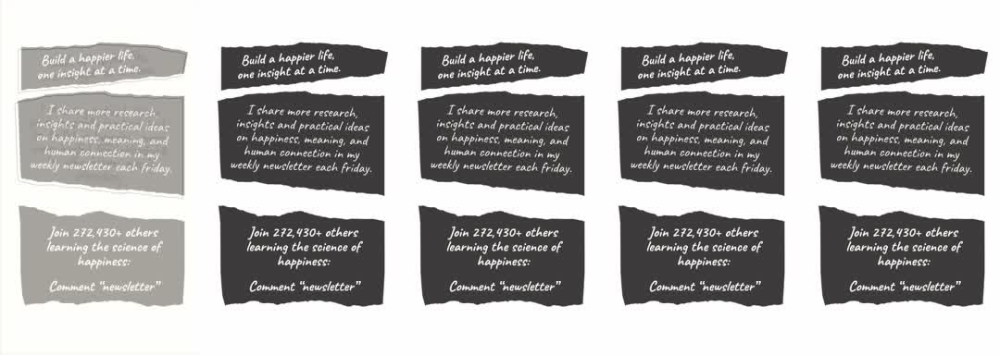

# v04_s20 · 14 Título - cierre - CTA · 55.0–57.5s (calidad 4)

- **Guion:** (sin voz) Texto CTA del newsletter.
- **Qué se ve:** Fondo blanco con 3 tiras de papel rasgado gris carbón: 'Build a happier life, one insight at a time.' / 'I share more research, insights and practical ideas on happiness, meaning, and human connection in my weekly newsletter each Friday.' / 'Join 272,430+ others learning the science of happiness: Comment "newsletter"'.
- **Diseño:** Tiras ~85 % ancho con bordes rasgados irregulares, fondo #3A3A3A, texto manuscrita itálica blanca pequeña centrada; apiladas de ~12 % a ~62 % alto.
- **Efectos:** Textura de papel rasgado (bordes).
- **Animación:** Corte seco; tarjetas estáticas (pantalla de lectura).
- **Por qué aquí:** CTA con prueba social (272k) y acción concreta (comentar) que alimenta el algoritmo.
