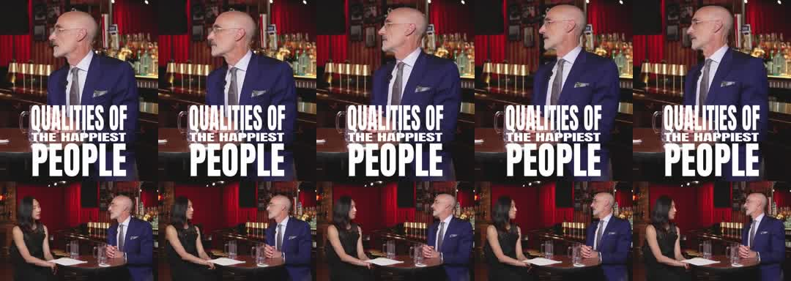

# v07_s01 · 14 Título - cierre - CTA · 0.0–3.4s (calidad 4)

- **Guion:** What are some of the qualities of the happiest people that you've met?
- **Qué se ve:** Pantalla dividida horizontal: arriba Arthur Brooks de pie en un bar (traje azul marino, corbata gris, barra con botellas y cortinas rojas); abajo plano general de la entrevistadora y él sentados en una mesa alta. Título superpuesto en la parte inferior de la mitad superior.
- **Diseño:** Título en MAYÚSCULAS sans condensada extra-bold (tipo Anton/Bebas/Druk): 'QUALITIES OF' grande, 'THE HAPPIEST' más pequeña y ancha (sans bold extendida), 'PEOPLE' la más grande. Blanco, alineado a la izquierda/centrado, ocupa ~70% del ancho, sobre la línea de división. Paleta del set: rojo #A0141E, ámbar, azul marino.
- **Efectos:** Sin texturas; ligera sombra en el título para legibilidad.
- **Animación:** Título estático desde el primer frame (sin animación visible en las muestras); la mitad superior tiene leve movimiento de cámara. Corte seco a A-roll a los 3.37 s.
- **Por qué aquí:** Hook: la pregunta del entrevistador se convierte en titular de promesa (qué tienen las personas más felices); el split muestra contexto (entrevista real) y al experto a la vez.
