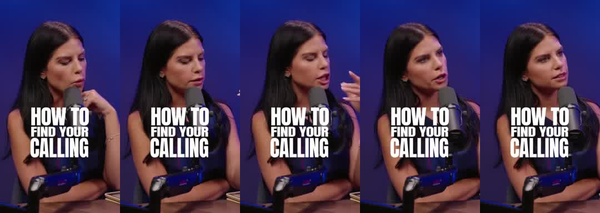

# v09_s01 · 14 Título - cierre - CTA · 0.0–3.1s (calidad 4)

- **Guion:** What if you can't figure out what your calling is?
- **Qué se ve:** Plano medio de la entrevistadora (pelo negro largo, top oscuro) con micrófono de podcast, fondo de cortinas azules iluminadas. Título grande superpuesto en el centro-izquierda.
- **Diseño:** Título en MAYÚSCULAS sans condensada extra-bold blanca (tipo Anton/Bebas/Druk): 'HOW TO' grande, 'FIND YOUR' más pequeña y más ancha, 'CALLING' grande. Bloque de 3 líneas alineado a la izquierda en el tercio medio, ~50% del ancho. Paleta: azul cortina #2A3FB0, negro.
- **Efectos:** Ninguno; iluminación azul del set.
- **Animación:** Título estático durante toda la pregunta; corte seco al speaker.
- **Por qué aquí:** Hook: la pregunta de la entrevistadora se transforma en promesa práctica 'HOW TO FIND YOUR CALLING'; ver a quien pregunta legitima el formato entrevista.
