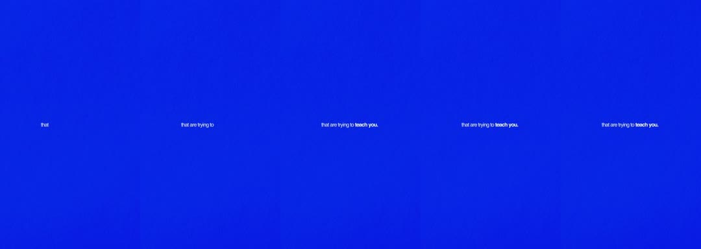

# v10_s59 · 14 Título - cierre - CTA · 107.7–110.8s (calidad 4)

- **Guion:** that are trying to teach you.
- **Qué se ve:** Fondo azul liso; frase pequeña 'that are trying to teach you.' con 'teach you.' en bold; termina en negro.
- **Diseño:** Sans pequeña blanca centrada a media altura, 'teach you.' bold. Azul #0B3FF5 con textura.
- **Efectos:** Textura de papel; fade a negro final.
- **Animación:** Write-on por palabra; hold ~2 s; fundido a negro.
- **Por qué aquí:** Cierre minimalista: la última palabra es la tesis ('enseñarte') en bold sobre el color de marca; no hay CTA explícito final porque ya se hizo en s46.
