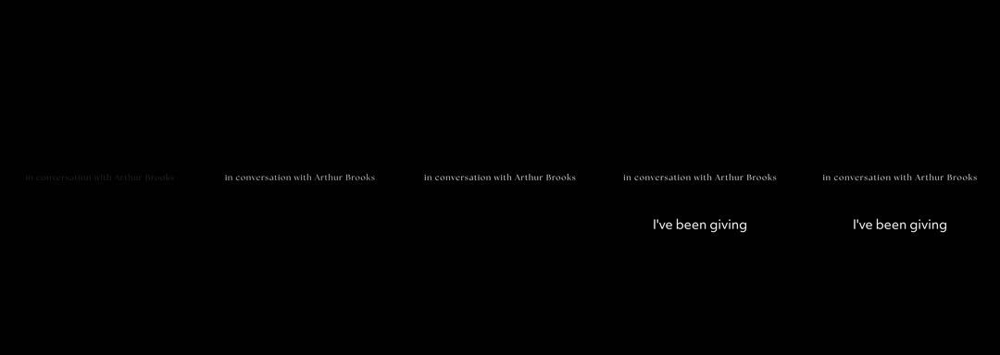

# v11_s16 · 14 Título - cierre - CTA · 21.1–23.6s (calidad 3)

- **Guion:** I've been giving
- **Qué se ve:** Cartón negro con crédito 'in conversation with Arthur Brooks' y debajo el caption 'I've been giving'.
- **Diseño:** Crédito en serif fina minúscula muy pequeña gris claro centrada a ~50 %; caption sans fina blanca a ~63 %. Fondo #000 con resto marrón de la transición.
- **Efectos:** Negro limpio.
- **Animación:** Fade del crédito (~0.4 s); caption aparece con la voz.
- **Por qué aquí:** Segundo crédito (presenta al invitado) colocado en el cambio de capítulo: de la pregunta al dato de Brooks.
