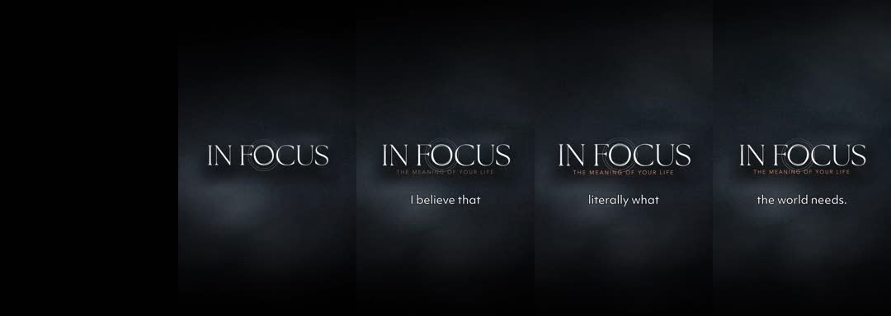

# v11_s32 · 14 Título - cierre - CTA · 70.3–76.3s (calidad 4)

- **Guion:** I believe that American Catholicism is literally what the world needs.
- **Qué se ve:** Cartón de título de la serie 'IN FOCUS' con subtítulo 'THE MEANING OF YOUR LIFE'; captions de la voz debajo.
- **Diseño:** 'IN FOCUS' serif de alto contraste MAYÚSCULAS blanca/plata, ~4× caption, centrada a ~48 %; la 'O' de FOCUS con un anillo/círculo fino orbitando; subtítulo sans MAYÚSCULAS pequeña con tracking amplio en naranja #E07A3A; caption sans fina blanca a ~63 %. Fondo gris-negro humeante #1A1A1C.
- **Efectos:** Textura de humo/niebla oscura, glow blanco detrás del título, viñeta fuerte.
- **Animación:** Título aparece con fade+blur-to-sharp (~0.6 s); subtítulo entra después; leve zoom-in lento continuo.
- **Por qué aquí:** Branding de la serie colocado justo después de la frase-tesis (pico emocional) y antes del CTA: asocia la marca al momento de mayor valor.
