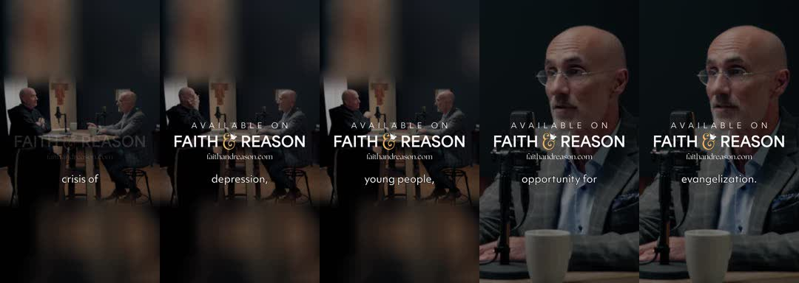

# v11_s34 · 14 Título - cierre - CTA · 77.3–82.3s (calidad 4)

- **Guion:** crisis of depression, anxiety among young people, that's the opportunity for evangelization.
- **Qué se ve:** Overlay de CTA 'AVAILABLE ON / FAITH & REASON / faithandreason.com' sobre el plano general de los dos (con foreground borroso) y luego sobre primer plano de Brooks.
- **Diseño:** 'AVAILABLE ON' sans MAYÚSCULAS fina con tracking muy amplio blanca; 'FAITH & REASON' sans geométrica bold blanca con '&' en serif itálica dorada (con paloma); URL serif pequeña blanca. Bloque centrado a ~42–55 %; caption a ~63 %.
- **Efectos:** Imagen de fondo oscurecida ~40 % y con foreground desenfocado; sin caja.
- **Animación:** Overlay hace fade-in (~0.4 s) y permanece fijo mientras cambian los planos debajo.
- **Por qué aquí:** CTA de plataforma mientras se oye la conclusión: el mensaje final y la llamada a la acción coinciden.
