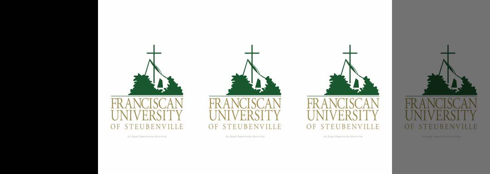

# v11_s36 · 14 Título - cierre - CTA · 83.8–90.2s (calidad 1)

- **Guion:** Thank you.
- **Qué se ve:** Logo de Franciscan University of Steubenville (cruz e iglesia en verde, texto en dorado oliva) centrado sobre blanco.
- **Diseño:** Logo institucional centrado a ~45 %; verde #1F5A2A, dorado #9A8A4E; fondo #FFFFFF/#F3F3F3.
- **Efectos:** Ninguno.
- **Animación:** Fade in desde negro; estático ~6 s.
- **Por qué aquí:** Firma institucional / end card de la productora.
