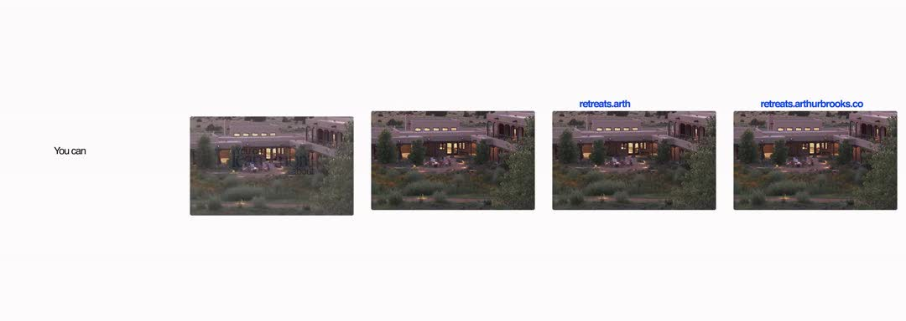

# v12_s44 · 14 Título - cierre - CTA · 85.9–91.3s (calidad 5)

- **Guion:** You can learn more about the upcoming retreats at retreats.Arthurbrooks.com.
- **Qué se ve:** Blanco con 'You can' en negro; aparece una tarjeta de vídeo redondeada con el edificio de adobe del retiro al anochecer (luces encendidas); encima se escribe 'retreats.arthurbrooks.com' en azul.
- **Diseño:** Tarjeta ~90 % del ancho, ratio ~16:10, radio ~2 %, centrada a ~45 %. Texto sans regular negra pequeña ('You can', 'the upcoming'), URL sans bold azul #1954F7 ~1.3× caption encima de la tarjeta. Fondo #FBF9FA.
- **Efectos:** Sombra muy sutil en la tarjeta.
- **Animación:** Tarjeta entra con fade+scale (0.95→1); la URL se escribe letra a letra (typewriter, ~1.5 s) sincronizada con la voz.
- **Por qué aquí:** CTA claro: lugar real + URL legible en el color de marca; typewriter = 'teclea esto'.
