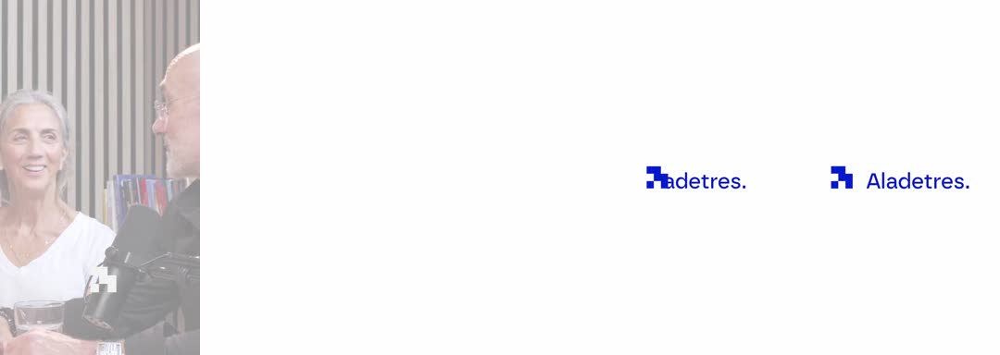

# v17_s16 · 14 Título - cierre - CTA · 48.5–52.4s (calidad 3)

- **Guion:** (outro)
- **Qué se ve:** Plano a dos que se lava a blanco (fade to white) y aparece el logo del canal 'Aladetres.' azul centrado.
- **Diseño:** Logo pixel + wordmark sans azul #1A2BE0 ~35 % ancho, centro, fondo blanco.
- **Efectos:** Sobreexposición progresiva a blanco.
- **Animación:** Fade-to-white ~1 s; logo fade-in.
- **Por qué aquí:** Firma de marca del canal de podcast.
