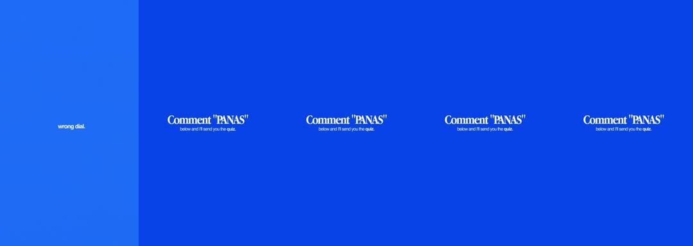

# v19_s53 · 14 Título - cierre - CTA · 106.0–110.1s (calidad 5)

- **Guion:** (CTA en pantalla)
- **Qué se ve:** Azul intenso; 'Comment "PANAS"' serif blanca bold + 'below and I'll send you the quiz.' diminuto con 'quiz' en bold.
- **Diseño:** Serif Didone blanca ~55 % ancho centro exacto; subtítulo sans ~2 %. Azul #0044EC.
- **Efectos:** Ninguno.
- **Animación:** Fade/pop suave y se mantiene ~4 s.
- **Por qué aquí:** CTA de comentario con palabra clave = algoritmo (comentarios) + lead magnet (quiz). Reusa la palabra 'PANAS' sembrada en 16 s.
