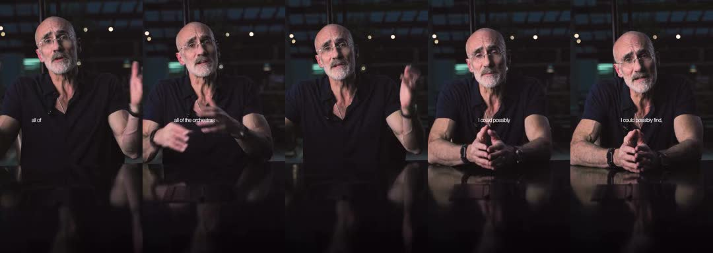

# v01_s18 · 15 A-roll sin texto · 30.4–32.4s (calidad 2)

- **Guion:** orchestras and ensembles I could possibly find,
- **Qué se ve:** A-roll plano medio, gestos amplios; captions pequeños 'all of the' / 'I could possibly find,'.
- **Diseño:** Sans pequeña blanca centrada a ~50 %, sin palabra grande.
- **Efectos:** Grade oscuro.
- **Animación:** Corte seco entre MS y MCU (punch-in).
- **Por qué aquí:** Narración de transición; el texto pequeño deja descansar la vista.
