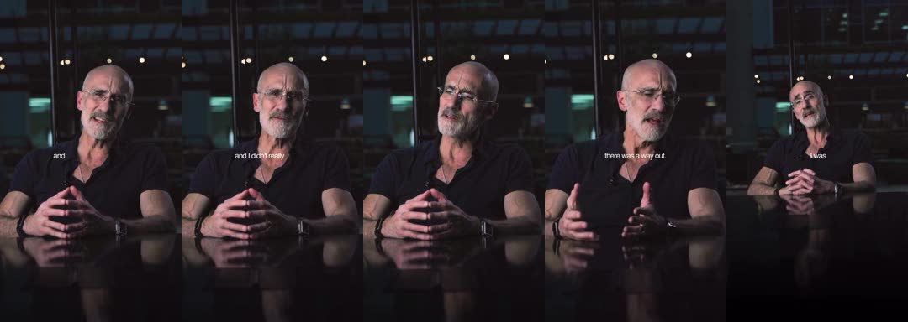

# v01_s26 · 15 A-roll sin texto · 47.2–50.5s (calidad 2)

- **Guion:** and I didn't really see that there was a way out. I was saved
- **Qué se ve:** A-roll plano medio, mirando fuera de cámara; caption pequeño 'and I didn't really see that'.
- **Diseño:** Sans pequeña blanca centrada ~48 %.
- **Efectos:** Grade oscuro.
- **Animación:** Cortes secos MS ↔ plano más abierto.
- **Por qué aquí:** Pausa de cara antes del giro positivo.
