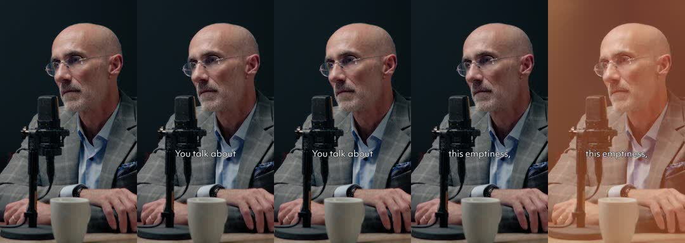

# v11_s01 · 15 A-roll sin texto · 0.0–0.8s (calidad 3)

- **Guion:** You talk about this emptiness,
- **Qué se ve:** Arthur Brooks en plano medio de perfil (3/4 a la izquierda), escuchando, americana gris de cuadros, micro de estudio negro delante y taza blanca en primer término. Fondo azul petróleo muy oscuro. La pregunta la hace el entrevistador en off.
- **Diseño:** Caption pequeño centrado a ~63 % de altura: sans geométrica fina tipo Outfit/Jost (regular, minúsculas, 2–3 palabras), blanco #FFFFFF con sombra suave. Ojos de Brooks en el tercio superior. Fondo #091217.
- **Efectos:** Grade cálido-cinematográfico: negros azulados, piel cálida, contraste medio, ligera viñeta, profundidad de campo corta (fondo desenfocado).
- **Animación:** Corte seco de entrada; caption cambia por frase corta (pop+fade ~0.1 s). Dura <1 s: plano de 'presentación' del protagonista antes de saltar al b-roll.
- **Por qué aquí:** Hook: lo primero que se ve es la cara del protagonista (autoridad) mientras se oye una pregunta emocional; ancla quién va a responder antes de la ráfaga de b-roll.
