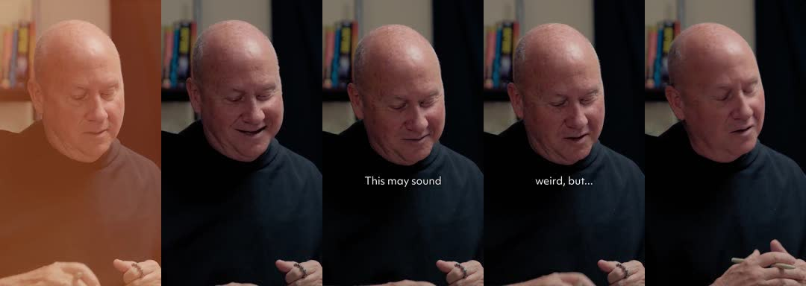

# v11_s05 · 15 A-roll sin texto · 3.9–6.0s (calidad 3)

- **Guion:** This may sound weird, but
- **Qué se ve:** Fr. Dave Pivonka (entrevistador) en primer plano, mirando hacia abajo, sonriendo, jersey negro de cuello alto, estantería con libros de colores desenfocada a la izquierda. Primer fotograma aún con tinte dorado del flash.
- **Diseño:** Caption sans fina blanca centrada a ~63 %: 'This may sound' / 'weird, but...'. Cara en tercio superior-central.
- **Efectos:** Grade cálido, fondo oscuro, desenfoque de fondo, viñeta suave.
- **Animación:** Entrada desde el light leak (cross de luz ~0.15 s). Plano fijo con micro-movimiento.
- **Por qué aquí:** Presentar al que pregunta = conexión humana; el 'esto puede sonar raro' crea curiosidad (open loop) que paga la escena siguiente.
