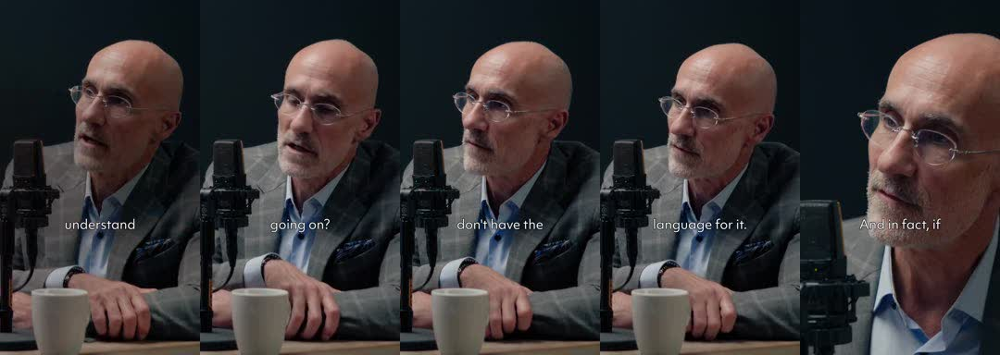

# v11_s10 · 15 A-roll sin texto · 9.7–13.0s (calidad 2)

- **Guion:** No, because they don't have the language for it. And in fact,
- **Qué se ve:** Brooks plano medio 3/4 mirando al entrevistador fuera de campo, micro y taza en primer término.
- **Diseño:** Caption sans fina blanca centrada a ~63 %, 2–3 palabras: 'No, because they', 'language for it.'.
- **Efectos:** Grade cálido cinematográfico, fondo azul oscuro #091217, viñeta.
- **Animación:** Corte seco; captions por golpe de frase.
- **Por qué aquí:** Respuesta directa del experto = cara a cámara (autoridad, conexión).
