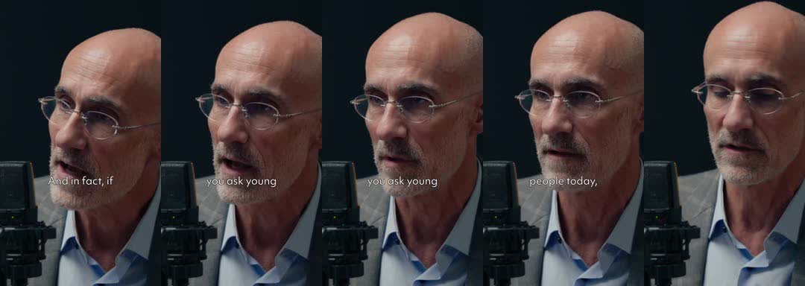

# v11_s11 · 15 A-roll sin texto · 13.0–15.5s (calidad 2)

- **Guion:** if you ask young people today,
- **Qué se ve:** Mismo plano de Brooks pero más cerrado (punch-in / segunda cámara más cerrada).
- **Diseño:** Caption igual ('you ask young').
- **Efectos:** Igual grade.
- **Animación:** Corte a plano más cerrado (jump-in) ~1.2×.
- **Por qué aquí:** El punch-in sube la intensidad justo antes del dato-anécdota que viene.
