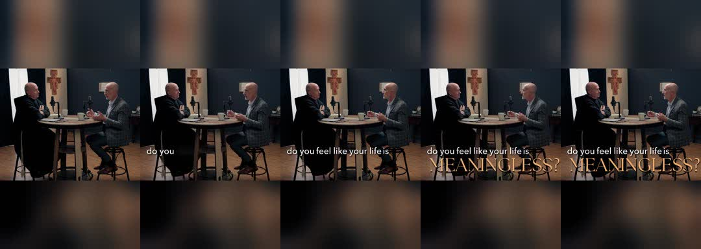

# v11_s12 · 15 A-roll sin texto · 15.5–18.2s (calidad 3)

- **Guion:** do you feel like your life is meaningless?
- **Qué se ve:** Plano general horizontal 16:9 de los dos (sacerdote con hábito y Brooks en mesa redonda, crucifijo de San Damián en la pared) encajado en una franja central; arriba y abajo, el mismo plano ampliado y desenfocado.
- **Diseño:** Franja 16:9 centrada entre ~30 % y ~57 % de altura; relleno superior/inferior = versión blur del propio plano. Caption 'do you feel like your life is' sans fina blanca sobre la parte baja de la franja.
- **Efectos:** Fondo blur extendido (blur-fill), oscurecido; grade cálido.
- **Animación:** Corte seco; plano estable.
- **Por qué aquí:** Plano de situación: recuerda que es una conversación (contexto) y da descanso visual antes del remate 'yeah'.
