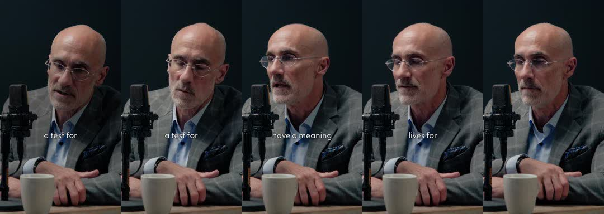

# v11_s17 · 15 A-roll sin texto · 23.6–28.4s (calidad 3)

- **Guion:** a test for whether people have a meaning crisis in their lives for many years.
- **Qué se ve:** Flash blanco de 0.2 s ('a test for' en gris) y entra Brooks plano medio, brazos sobre la mesa, mirando abajo-izquierda.
- **Diseño:** Caption sans fina blanca centrada a ~63 %: 'a test for', 'have a meaning', 'lives for'.
- **Efectos:** Flash blanco de entrada; grade cálido.
- **Animación:** Flash blanco seco (~0.2 s) → corte; plano fijo.
- **Por qué aquí:** Anuncio de algo nuevo (su test) = cara del speaker; el flash blanco subraya el inicio del argumento.
