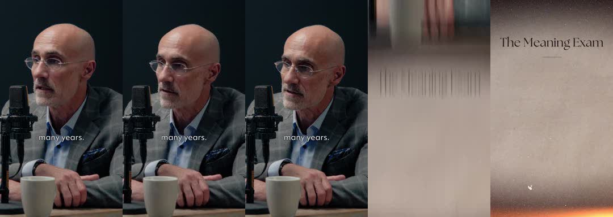

# v11_s18 · 15 A-roll sin texto · 28.4–29.6s (calidad 3)

- **Guion:** The first question is,
- **Qué se ve:** Transición: barrido con motion blur vertical y distorsión tipo 'glitch'/franjas (barcode) que pasa del plano de Brooks a una textura de papel beige.
- **Diseño:** Tonos grises-beige #B9AFA3; franjas verticales oscuras.
- **Efectos:** Motion blur direccional, glitch de líneas verticales, desenfoque.
- **Animación:** Whip/slide vertical rápido (~0.3–0.5 s), seco.
- **Por qué aquí:** Transición enérgica que marca 'ahora viene el contenido concreto' (el examen).
