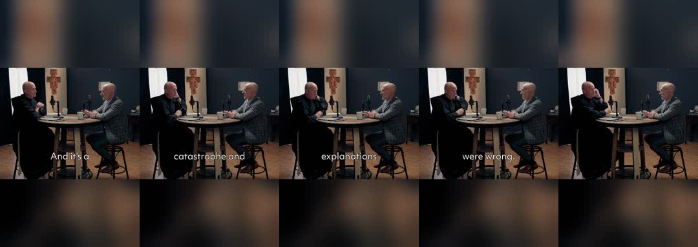

# v11_s23 · 15 A-roll sin texto · 41.6–44.1s (calidad 2)

- **Guion:** It's a catastrophe and all the explanations were wrong.
- **Qué se ve:** Plano general horizontal de los dos en la mesa, encajado en franja central con relleno blur arriba/abajo.
- **Diseño:** Franja 16:9 centrada; caption 'all the' en la franja.
- **Efectos:** Blur-fill oscuro.
- **Animación:** Corte seco.
- **Por qué aquí:** Contexto/descanso tras el dato; plano abierto = conclusión ('es una catástrofe').
