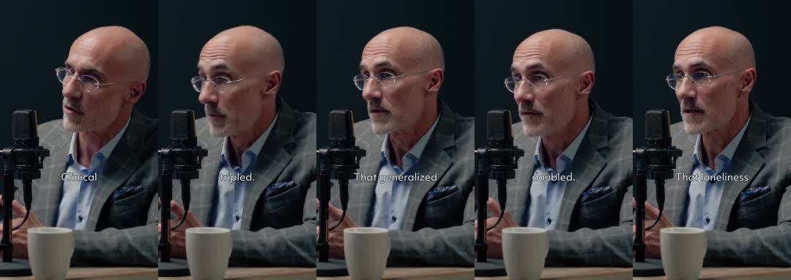

# v11_s24 · 15 A-roll sin texto · 44.1–48.4s (calidad 2)

- **Guion:** Clinical depression has tripled. That generalized anxiety has doubled. That loneliness is up.
- **Qué se ve:** Brooks en plano medio, cambio de ángulo (3/4 izquierda → más frontal) mientras enumera.
- **Diseño:** Caption sans fina blanca ~63 %: 'Clinical', 'doubled.'.
- **Efectos:** Grade cálido.
- **Animación:** Cortes de cámara entre ángulos cada ~1.5 s siguiendo cada dato.
- **Por qué aquí:** Lista de datos rápidos: el ritmo de cortes la sostiene sin gráficos (evita saturar tras el 50 %).
