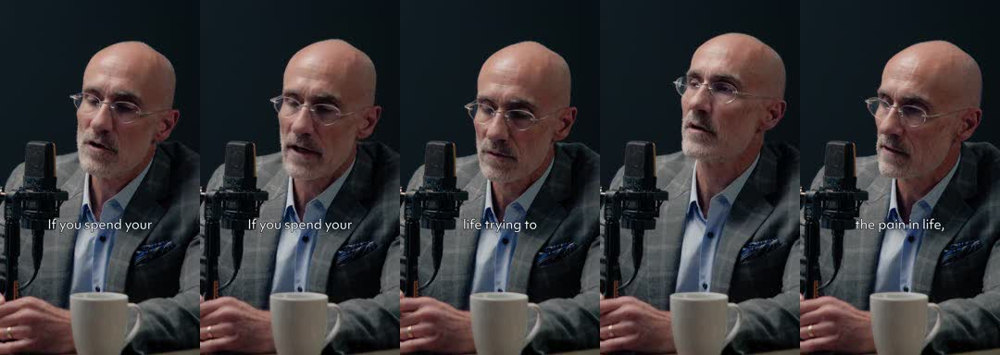

# v11_s29 · 15 A-roll sin texto · 61.0–67.4s (calidad 2)

- **Guion:** If you spend your life trying to exempt yourself from suffering, trying to avoid the pain in life,
- **Qué se ve:** Brooks plano medio 3/4 escuchando/hablando, micro y taza delante.
- **Diseño:** Caption sans fina blanca ~63 %: 'If you spend your', 'exempt yourself', 'trying to avoid'.
- **Efectos:** Grade cálido.
- **Animación:** Plano fijo largo (~6 s) — la escena más larga de A-roll, deja crecer la frase.
- **Por qué aquí:** Construcción de la frase-tesis final: se mantiene la cara para que la conclusión venga de él.
